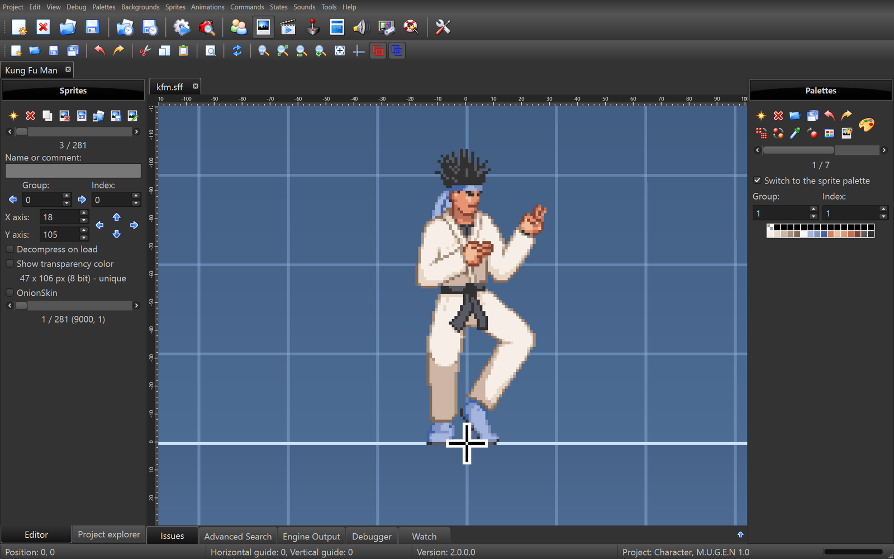
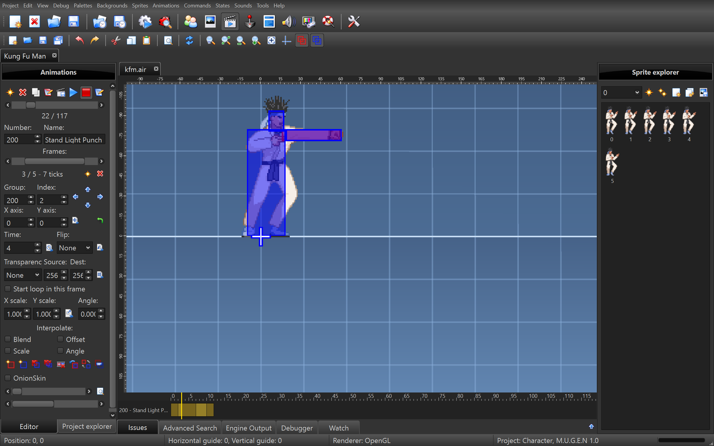
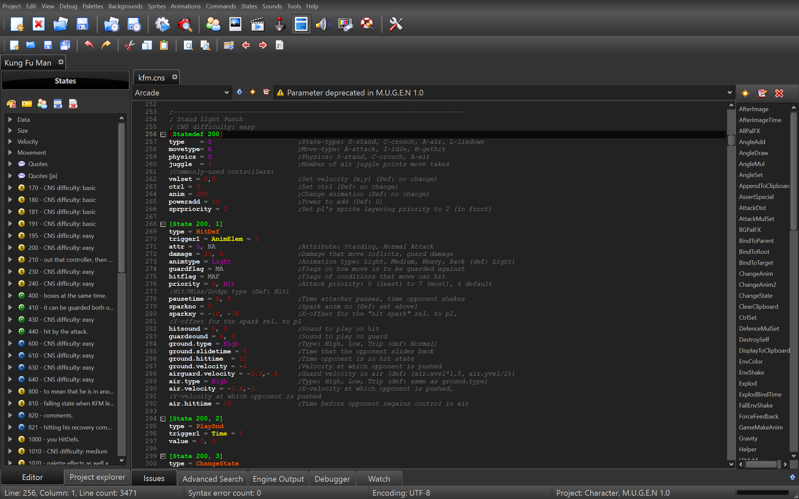
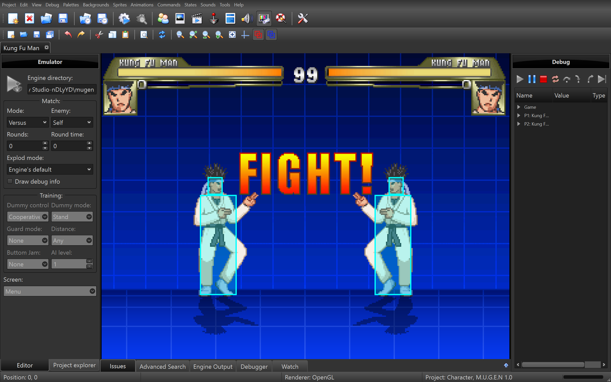

# Open Factory Studio

A free editor for M.U.G.E.N characters, stages and screenpacks. It looks and works like Fighter Factory Studio 3.7, so if you've used that, you'll find your way around.

It has editors for sprites, animations, palettes, sounds, backgrounds and code, and a built-in emulator to try characters without leaving the editor. It runs on Windows, Linux and macOS.

  
  
  
  

## Download

Get it from the [releases page](https://github.com/HBProductionOfficial/OpenFactoryStudio/releases). For Windows there is an installer and a portable zip, for Linux an AppImage.

No game files come with it. The emulator and Run in engine use your own M.U.G.E.N folder.

## Building

See docs/Building.pdf.

## License

GPL-3.0, see LICENSE. The libraries it uses are listed in "Third party notices.pdf".
